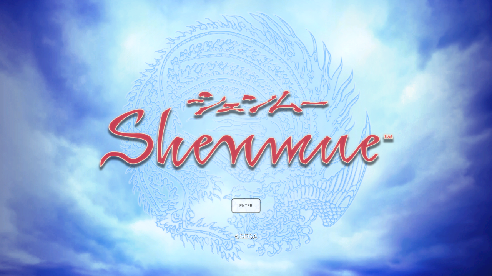
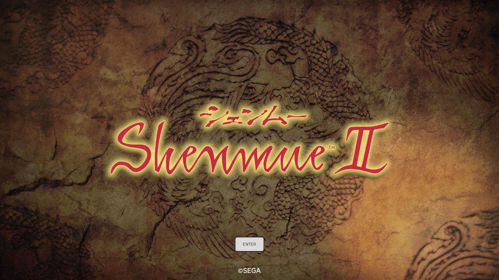
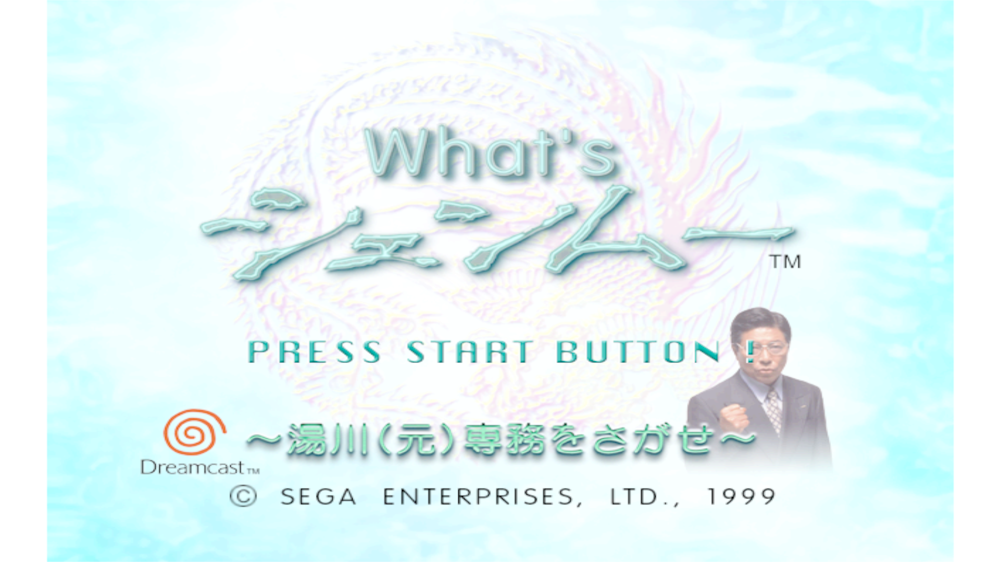
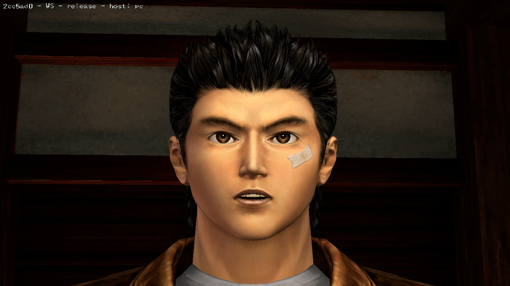
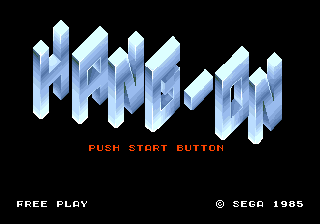

# Shenmue I & II 

This repository contains a C/C++ reimplementation of Shenmue I & II for PC and Dreamcast, including the What's Shenmue promotional demo. 

The original code is derived from a **completed C decompilation project** which began in 2018. In total there are ~14 executables which have been surfaced. 

The purpose of this repository is to maintain a codebase which shares as much as possible while maintaining modern interoperability with the original releases, the Demo and the PC versions. 

### Targets

- Windows
- Linux
- Dreamcast

### Libs

- [ShenmueDK](https://github.com/Shenmue-Mods/ShenmueDK)

### Build

`git submodule update --init --recursive && cmake -S . -B build/windows-asi -G "Visual Studio 17 2022" -A x64 "-DCMAKE_TOOLCHAIN_FILE=%VCPKG_ROOT%/scripts/buildsystems/vcpkg.cmake" -DVCPKG_TARGET_TRIPLET=x64-windows-static "-DCMAKE_MSVC_RUNTIME_LIBRARY=MultiThreaded$<$<CONFIG:Debug>:Debug>" -DSHENMUE_STEAM=ON -DSHENMUE_RT_ARCADE=ON -DSHENMUE_LOAD_HANGON_DLL=ON && cmake --build build/windows-asi --config Release --target shenmue1_asi shenmue2_asi --parallel 4`

### Hang-On Standalone

This repository also provides a standalone executable that uses the included Hang-On emulator that is distributed with the 2018 re-releases of Shenmue I & II. 

To use it, download the prebuilt binaries or build from source, and place the executable in either the `sm1` or `sm2` directory and run it. 

## Contributing

Contributors are welcome, if you are interested, please get in contact or open an issue. 

The project is under active development and refactoring, hence the currently temporary license. 

Contributions involving new code or modifications to existing code are welcome, subject to agreement on preferred licensing. Contributions will be credited.

## Special Thanks

The below individuals have helped me with some of the initial research, either directly or indirectly:-

- PhilYeahz - contributed to research/RE and SDK development
- derplayer - contributed to research/RE and SDK development
- davi - contributed to Forklift and provided other assistance
- Raymonf - contributed to Forklift and provided other assistance
- Sappharad - poked me to look into the AICA abstraction more than I was initially going to, to which we both provided RE details about, and provided implementations in the ao_sdk
- ShenTrad team - the team behind the original dialogue/subtitle modding tools for the original DC games, amongst other tools, provided an excellent resource for the initial research.

## Disclaimer

I do not support nor condone piracy. Developers worked hard to bring enjoyment to the home and this takes a lot of time, effort, patience, ingenuity and is an art form in of itself. There is value in that and I respect that and want any use of this repository to be used in a non-infringing manner. I do not claim any rights, intellectual property or copyright over any of the recovered code. You must own the original game to use it. There are no assets provided with this.

The code is published explicitly for research purposes and ethical modding for the game which you have already bought or otherwise own.
